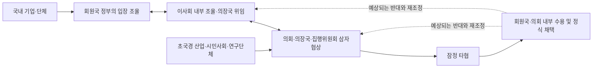

# Graphify의 입법 흐름과 B 분석의 비교

확인: B / 2026-11-16

**수정 판단: Graphify에서 찾은 관련 자료는 B의 설명과 대체로 부합하지만, 그래프 자체가 입법의 시간 순서나 인과 흐름을 입증하지는 않는다.** 실제 `graph.json`의 `directed` 값은 `false`다. 즉 방향 없는 관계망이다. 앞선 ‘큰 흐름은 일치한다’는 표현은 자료를 날짜와 맥락에 맞게 재배열한 결과에 한정한다.

‘외부 요구 → 정부·회원국 조율 → 의장국 위임 → 기관 간 타협 → 내부 수용’은 **B가 구성한 분석 순서**다. 원래 그래프에서 방향을 추출한 결과가 아니며, 퍼트남 원문이 강조한 사전 협의와 반복적 조정까지 설명하려면 순환을 함께 고려해야 한다. [S19](04_근거자료와_검증한계.md#s19)

## 실제 그래프와 대조한 결과

[graph.json](../graphify-out/graph.json)의 노드·연결·출처 위치를 읽고 아래 자료군의 EXTRACTED 연결을 확인했다. 커뮤니티 번호는 [기존 그래프 보고서](../graphify-out/GRAPH_REPORT.md)의 번호다.

`EXTRACTED`는 출처에서 관계가 추출됐다는 표지다. 발언의 사실성, 정책 영향, 인과 방향을 독립적으로 인증하는 등급으로 취급하지 않는다.

| 단계 | Graphify에서 확인한 연결·자료군 | B와의 관계 |
|---|---|---|
| 외부 요구 | D14: Aleph Alpha와 정량 차등 규제 반대·조건부 대안, D10: DIGITAL SME와 후속 기업 부담 | 공급자와 후속 기업의 선호 차이라는 분석이 같음 |
| 공동 입장 | D07: 프독이 공동 입장·자율규제·모델카드·초기 제재 유보 | 최초 요구와 최종 결과를 구별하는 기준이 같음 |
| 내부 조율과 위임 | D17 PDF 24쪽: 독일 정부 내부 공동 조율 → 공동 문서 → 이사회 의장국 협상 위임 → 삼자협상 | 양면게임을 적용하는 핵심 경로가 같음 |
| 위임 수정과 타협 | C02: 11월 29일·12월 1일 수정 권한, 12월 6–8일 정치적 합의, GPAI 차등 의무 | 절차와 시간 순서가 같음 |
| 합의 이후 수용 | D19: 문화·미디어 업계 → COREPER 승인 촉구 → 독일 정부 | 합의 뒤에도 내부 요구가 이어진다는 분석이 같음 |

표의 화살표는 원문 내용을 요약한 표시다. 특히 D19는 ‘승인 요구’ 자료이며 ‘실제 승인’은 S25·S26으로 별도 보강했다. [S25](04_근거자료와_검증한계.md#s25) · [S26](04_근거자료와_검증한계.md#s26)

관련 주제 묶음은 6번 ‘독일 정부 내부 조율’, 14번 ‘최종 타협과 입법 경과’, 17번 ‘의무적 자율규제 요구’, 28번 ‘기업 의견 전달 기록’, 31번 ‘후속 중소기업의 규제 요구’, 35번 ‘입법과 적용의 구분’이다.

## 비교할 때 달라지는 세 가지

1. **범위:** Graphify에는 2021년 제안, 2022년 이사회 접근, 2023년 의회 입장, 이후 채택·발효·적용까지 들어 있다. B는 그중 2023년 하반기 협상과 뒤이은 수용 국면을 집중 분석했다. B 문서를 입법 전 과정의 연혁으로 읽으면 범위가 좁다.
2. **증거의 독립성:** 두 정리는 D14·D17·C02·D10·D19 등 같은 자료를 상당 부분 공유한다. 따라서 일치한다는 사실 자체가 별도의 독립 검증은 아니다. B가 새로 확보한 Mozilla·오픈소스·DIGITALEUROPE 자료 등은 외부 이해관계자의 범위를 보완한다.
3. **관계와 인과:** 그래프에서 두 개념이 연결됐다고 지지 관계나 인과가 자동으로 성립하지 않는다. 예를 들어 프독이는 차등 규제와 연결되지만 그 최초 입장은 반대였다. D17의 전달 기록과 C02의 위임 수정 기록 사이에서도 특정 문구의 반영 경로는 추가 확인이 필요하다.

## 그래프의 시점

기존 보고서는 2026-11-14의 스냅샷이다. 이번 확인에서 `B/`를 출처로 하는 노드는 없었다. 따라서 기존 그래프가 B의 새 문서를 이미 포함한다고 설명할 수 없다. 이 비교에서는 그래프를 다시 생성하거나 수정하지 않았다.

## 발표에 반영할 판단

‘산업계 반대 → 프독이 압박 → 규제 완화’로 줄이면 자료에 나타난 갈등과 조율이 빠진다. **상충하는 요구를 정부·EU 기관이 받아들이고, 내부 지지를 고려한 대표들이 교섭하며, 타협을 다시 내부에 설명하고 승인받는 과정**으로 제시한다. 아래 그림은 이론적 관찰 틀이며 모든 화살표가 실증된 것은 아니다.

실선의 개별 근거와 인과의 공백은 [02번 문서](02_퍼트남_양면게임_분석.md)에 구분했다. 양방향·점선은 반복적 조정을 살펴볼 분석 틀이다. 이를 기존 Graphify 원본에서 추출한 방향으로 설명하지 않는다.

각 단계의 1차 자료와 검증 한계는 [근거자료 안내](04_근거자료와_검증한계.md)에 연결돼 있다.
